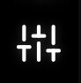

# プロジェクト設定

Chlorosの「プロジェクト設定」

サイドバーでは、画像処理、キャリブレーションターゲットの検出、マルチスペクトル指数の計算、およびプロジェクトのエクスポートオプションなど、あらゆる側面を設定できます。これらの設定はプロジェクトとともに保存され、テンプレートとして保存して複数のプロジェクトで再利用することも可能です。

## プロジェクト設定へのアクセス

プロジェクト設定にアクセスするには：

1. Chlorosでプロジェクトを開きます
2. 左側のサイドバーにある**プロジェクト設定** 

タブをクリックします
3. 設定パネルに、カテゴリ別に整理された利用可能なすべての設定オプションが表示されます

<!-- SCREENSHOT-NEEDED: Full Project Settings sidebar of a LATTICE project, scrolled so the Processing category is visible showing the per-product export checkboxes (Export sensor response, Export vignette corrected, Export debayered, Export preview, Export radiance, Export reflectance) and the Debayer method row. -->


**他の設定に依存する設定はグレー表示されます。** 親となるスイッチの設定により、ある設定が不可能になる場合（例：*「反射率キャリブレーション／ホワイトバランス」*のチェックを外すと、*「反射率のエクスポート」*が不可能になる）、依存するコントロールは無効化され、そのツールチップには変更が必要なスイッチ名が表示されます。


***

## 表示

### 画像サムネイルの解像度

* **タイプ**: ドロップダウン選択
* **オプション**: `Default (512 px)`、`1024 px`、`2048 px`、`Full resolution`
* **デフォルト**: デフォルト (512 px)
* **説明**: 画像グリッドのサムネイルがレンダリングされる解像度（最長辺、ピクセル単位）。値が大きいほど、ズームインした際に鮮明に見えますが、読み込みに時間がかかり、メモリを多く消費します。フル解像度を選択すると、元の画像サイズで表示されます。
* **注**: 表示専用 — 処理やエクスポートされたファイルには一切影響しません。***

## ターゲット検出

これらの設定は、Chlorosが画像内のキャリブレーションターゲットをどのように検出して処理するかを制御します。どちらも、**反射率キャリブレーション / ホワイトバランス**が有効になっている間のみ有効です（それ以外の場合は、ターゲット検出が完全にスキップされるため、グレーアウトされます）。

### 最小キャリブレーションサンプル領域 (px)

* **タイプ**: 数値
* **範囲**: 0 ～ 10,000 ピクセル
* **デフォルト**: 25 ピクセル
* **説明**: 検出された領域が有効なキャリブレーションターゲットサンプルとみなされるために必要な最小面積（ピクセル単位）を設定します。値を小さくすると、より小さなターゲットを検出できますが、誤検出が増える可能性があります。値を大きくすると、検出にはより大きく、鮮明なターゲット領域が必要になります。
* **調整すべき場合**:
  * 画像の小さなアーティファクトで誤検出が発生する場合は、この値を大きくしてください
  * 画像内でキャリブレーションターゲットが小さく表示され、検出されない場合は、この値を小さくしてください

### 最小ターゲットクラスタリング (0-100)

* **タイプ**: 数値
* **範囲**: 0 ～ 100
* **デフォルト**: 60
* **説明**: キャリブレーションターゲットを検出する際、類似した色の領域をグループ化するクラスタリングの閾値を制御します。値が大きいほど、グループ化されるために必要な色の類似度が高くなり、ターゲットの検出がより厳格になります。値が小さいほど、ターゲットグループ内の色のばらつきが許容されます。
* **調整すべき場合**:
  * キャリブレーションターゲットが複数の検出に分割されてしまう場合は、値を大きくしてください
  * 色のばらつきがあるキャリブレーションターゲットが完全に検出されない場合は、値を小さくしてください

***

## 処理

これらの設定は、Chlorosによる画像の処理およびキャリブレーション方法を制御します。

### ヴィネット補正

* **タイプ**: チェックボックス
* **デフォルト**: 有効（チェック入り）
* **説明**: 画像の端でのレンズの暗さを補正するために、ヴィネット補正を適用します。ヴィネットとは、レンズの特性により、画像の隅や端が中央よりも暗く見える一般的な光学現象です。
* **副作用**: このスイッチは、実行時に書き出される *未校正のフォールバック製品* の選択にも影響します（以下を参照）。

### 反射率校正 / ホワイトバランス

* **タイプ**: チェックボックス
* **デフォルト**: 有効（チェック済み）
* **説明**: 反射率キャリブレーションを有効にします。カメラの種類や利用可能なデータに応じて、フレーム内で検出されたキャリブレーションターゲットおよび／またはDAQの光センサーによるダウンウェルデータに基づいて行われます。これにより、データセット全体の反射率値が正規化され、照明条件にかかわらず一貫した測定値が得られます。
* **無効の場合**：ターゲット検出は完全にスキップされ、**どのカメラでも反射率プロダクトを生成できません** — Survey3のターゲット駆動型およびLATTICE DAQ駆動型を問わず同様です。関連する設定（*反射率のエクスポート*、*最小再校正間隔*、およびターゲット検出の閾値）はグレーアウトされます。

### キャリブレーション未実施時の代替データ：センサー応答のエクスポート / ヴィネット補正済みデータのエクスポート

* **タイプ**：2つのチェックボックス
* **デフォルト**：両方とも有効（チェック済み）
* **説明**：フレームの反射率キャリブレーションができない場合（キャリブレーションターゲットが見つからない、または反射率キャリブレーションがオフになっている）、そのフレームは代わりに*未キャリブレーションのフォールバックデータ*として書き出されます。**各カメラモデルごとに、1回の実行につき2つのフォールバック製品のうち、*ヴィネット補正*スイッチによって選択された**1つだけ**が存在します：
  * ヴィネット補正 **オン**→ `Vignette_Corrected_Images/`（**ヴィネット補正済みとしてエクスポート**の設定に従う）
  * ヴィネット補正 **オフ**→ `Sensor_Response_Images/`（**センサー応答としてエクスポート**の設定に従う）
* 適用されていないフォールバックはグレー表示されます。適用中のフォールバックのチェックを外すと、そのファイルは一切書き込まれなくなります。

### LATTICE エクスポート製品

LATTICE キャプチャを含むプロジェクトの場合、インポートされた各 LATTICE フレームは、1回の処理パスで、有効かつ**適用可能な**すべての製品にファンアウトされます。 ファンアウトは4つのチェックボックスで制御されます（すべてデフォルトで**オン**）：

| 設定 | 出力フォルダ | エクスポート内容 |
| --- | --- | --- |
| **デベイヤー処理済みを出力** | `Debayered_Images/` | 線形デベイヤー処理済み画像： キャリブレーションパックのダークオフセットを除去した後、エッジを意識したデモザイク処理を施したもの。線形性補正、フラットフィールド補正、アンミックスは行われていません。これは、キャプチャがデベイヤー処理済みレベルで保存するファイルと同じものです。センサーのネイティブ方向（XMPに記録されたもの）が保持されます。RGBおよびマルチスペクトルカメラに適用されます。 |
| **プレビューのエクスポート** | `Preview_Images/` | 画面上のプレビュー。RGB = ホワイトバランス（利用可能な場合はDAQ光源、それ以外はグレイワールド）＋ガンマ；マルチスペクトル = 偽色伸張。 |
| **放射輝度をエクスポート** | `Radiance_Images/` | W/m²/sr/nm 単位の Float32 スペクトル放射輝度。マルチスペクトル（M3C/M3M）のみ — RGBマスターには適用されません。 *校正済み画像形式*の設定にかかわらず、常に32ビットTIFFとして書き込まれます。 |
| **反射率のエクスポート**| `Reflectance_Calibrated_Images/` | Uint16の反射率。**32768 = 反射率 1.0**となるようスケーリングされています （XMPとして`Chloros:PixelScale`とスタンプされる）。マルチスペクトルのみ。対応する`.daq`のダウンウェルリングレコード（またはQAに合格したフレーム内ターゲット）がフレームをカバーしている場合に書き込まれる。 |

* RGBマスターカメラは、デベイヤー処理済みデータとプレビューデータを出力します。これらのカメラについては、放射度/反射率は適用されないため、書き込まれません。
* デベイヤー処理済みデータおよびプレビューデータのビット深度は、*「校正済み画像フォーマット」*の設定に従います。放射度は常にfloat32です。
* Survey3処理は、これら4つのトグルの影響を受けません。
* マルチスペクトル M3C カメラの放射輝度および反射率データについても、ピクセルごとの **クランプマスク**を、プロダクトフォルダに隣接する`clamp_masks/`フォルダに書き込むことができます。これにより、バンドのアンミックス処理において負の値がゼロに切り詰められた箇所が記録されます。[出力画像フォーマット](../output-image-formats.md#clamp-masks)を参照してください。

これら4つのトグルは、ヘッドレスモードでも `chloros-cli process --debayered / --preview / --radiance / --reflectance` として存在します。これらは、現在は存在しない旧来の CLIフラグ `--radiometric-output` に取って代わりました。


**該当するすべてのプロダクトを無効にすると、実行は失敗します。** バージョン 1.2.0 以降、プロダクトの出力を要求されたにもかかわらず画像プロダクトを書き出さなかった処理実行は、黙って成功と報告されるのではなく、失敗として報告され、CLIはゼロ以外の値で終了します。ログには、書き出せなかったプロダクトとその理由が記載されます。意図的にメタデータのみの出力を指定した実行 （要求なし）は、依然として成功とみなされます。


### 反射率ソース（プロジェクト設定、CLI

経由で設定）

プロジェクトには、LATTICE反射率プロダクトが使用する**反射率基準**も保存されます。 設定パネルには専用のコントロールはありません。この値はプロジェクト構成に `Processing → "Target reflectance source"` として保存され、`chloros-cli process --reflectance-source {auto,target,daq}` （SDKの`configure()`にはこれに対応するキーワードがありません）：

* **`auto`**（デフォルト）：QAに合格したフレーム内キャリブレーションターゲットが絶対基準となります。ターゲットが存在しない場合やQAに失敗した場合は、DAQのダウンウェル除算（ρ = πL/E）にフォールバックします。 フラグ付き（パネルの落下やバンドの不具合など）でQAに合格したターゲットは、自動的に優先されるわけではありません。ターゲットのみ、ターゲット＋DAQ、DAQのみのチェーンが、保留パネルでの測定スコア順に試行されます。
* **`target`**: 厳密なターゲット主導型反射率 — DAQによる置換は行われない。
* **`daq`**: DAQを優先する反射率；フレーム内のターゲットは基準として使用されない。

保存された値は大文字小文字を区別せずに照合され、いくつかの表記が別名として受け入れられます：`target`、`target_image`、 `empirical`、`empirical_line`はすべて**ターゲット**を意味します。 `daq`、`dls`、`light_sensor`、および `sensor` はすべて**daq**を意味します。それ以外（キーが存在しない場合も含む）はすべて**auto** として扱われます。

単位ごとの **測定済み** ターゲットスキャンは、ターゲット単位のシリアル番号/QR に基づいて（例：`<serial>.csv`）、以下の 3 箇所で参照されます： `--target-reflectance-dir` で指定されたディレクトリ（`Processing → "Target reflectance dir"` として保存）、プロジェクト固有の `target_reflectance/` フォルダ、 および環境変数 `CHLOROS_TARGET_REFLECTANCE_DIR` に指定されたパスです。そのユニットに対して測定済みスキャンが存在しない場合、代わりにターゲットモデルの公表された公称曲線が使用されます。

### デベイヤー法

* **タイプ**: ドロップダウン選択
* **オプション**:
  * 標準 (高速、中程度の画質)
  * テクスチャ対応 (低速、最高画質) \[Chloros+]
* **デフォルト**: 標準 (高速、中程度の画質)
* **説明**: ベイヤー配列の生センサーデータをフルカラー画像に変換するために使用するデモザイクアルゴリズムを選択します。「標準（高速、中程度の画質）」方式は、処理速度と画質の最適なバランスを提供します。「テクスチャ対応（低速、最高画質）」 \[Chloros+]は、高品質なエッジ認識型デベイヤーとAI/MLノイズ除去モデルを組み合わせており、デベイヤー処理によるノイズをほぼ完全に除去します。テクスチャ認識モデルを実行するにはGPUメモリ（VRAM）が必要です。処理を高速化するため、4GB以上のVRAMが利用可能な場合に使用することをお勧めします。
* **その行がドロップダウンである場合**：2つの選択肢からなるドロップダウンは、**両方の**条件が満たされた場合にのみ表示されます。つまり、対象となるChloros+サブスクリプションでログインしていること、**かつ**プロジェクトにLATTICEキャプチャが含まれていないことです。それ以外の場合は、その行は「`Standard (Fast, Medium Quality)`」というプレーンテキストとして表示され、選択可能な項目は表示されません。
* **LATTICEに関する注意**: LATTICE用にトレーニングされた「Texture Aware」モデルは存在せず、パイプラインは保存された値にかかわらず、LATTICEフレームに対して標準のデモザイク処理を強制します。すでに「Texture Aware」が選択されているプロジェクトにLATTICEフォルダを追加した場合、Chlorosは`project.json`に古い値を残すのではなく、設定を「標準」に戻し直します。

### 再キャリブレーションの最小間隔

* **タイプ**: 数値
* **範囲**: 0 ～ 3,600 秒
* **デフォルト**: 0 秒
* **説明**: キャリブレーションターゲットを使用する間の最小時間間隔（秒単位）を設定します。0に設定すると、Chlorosは検出されたすべてのキャリブレーションターゲットを使用します。より大きな値に設定すると、Chlorosはこの秒数以上間隔が空いているキャリブレーションターゲットのみを使用するため、キャリブレーションターゲットが頻繁にキャプチャされるデータセットの処理時間を短縮できます。
* **調整すべき場合**:
  * 照明条件が変動する場合は、キャリブレーションの精度を最大化するために 0 に設定してください
  * 照明が一定で、キャリブレーションターゲットの画像が頻繁に取得される場合は、処理を高速化するために値を大きくしてください（例：60～300 秒）

### 光センサーのタイムゾーンオフセット

* **タイプ**: 数値
* **範囲**: -12 ～ +12 時間
* **デフォルト**: 0 時間
* **説明**: 光センサーデータのタイムスタンプに対するタイムゾーンオフセット（UTCからの時間）を指定します。これは、光センサーのログを画像の撮影時刻と照合する際に使用されます。新しい`.daq`の記録には独自のタイムゾーン情報が含まれているため、この設定は主に現地時間で記録された古いログに対して必要となります。

### PPK補正の適用

* **タイプ**: チェックボックス
* **デフォルト**: 無効 （チェックなし）
* **説明**：GPS（GNSS）を搭載したMAPIR DAQレコーダーからのPPK（Post-Processed Kinematic）補正の使用を有効にします。有効にすると、Chlorosはプロジェクトディレクトリ内にある露光ピンデータを含む.daqログファイルを使用し、画像に正確な位置情報補正を適用します。
* **要件**：プロジェクトディレクトリに、露出ピンエントリを含む .daq ログファイルが存在している必要があります
* **有効にするタイミング**：.daq ログファイルに露出フィードバックエントリが含まれている場合は、常に PPK 補正を有効にすることを推奨します。

### 露出ピン 1

* **タイプ**: ドロップダウン選択
* **表示条件**: 以下の条件が満たされた場合にのみ表示されます 「PPK補正を適用」が有効であり、かつピン1の露出データが利用可能な場合のみ表示されます
* **オプション**:
  * プロジェクト内で検出されたカメラモデル名
  * 「使用しない」 - この露出ピンを無視します
* **デフォルト**: プロジェクトの設定に基づいて自動選択されます
* **説明**: PPK 時刻同期のために、特定のカメラを露出ピン 1 に割り当てます。露出ピンは、カメラのシャッターが切られた正確なタイミングを記録し、これは正確な PPK 位置特定に不可欠です。
* **自動選択の動作**:
  * カメラ1台＋ピン1本：カメラを自動的に選択
  * カメラ1台＋ピン2本：ピン1が自動的にカメラに割り当てられる
  * 複数のカメラ：手動での選択が必要

### 露出ピン 2

* **タイプ**: ドロップダウン選択
* **表示**: 「PPK補正を適用」が有効であり、かつピン 2 の露出データが利用可能な場合にのみ表示されます
* **オプション**:
  * プロジェクト内で検出されたカメラモデル名
  * 「使用しない」 - この露出ピンを無視する
* **デフォルト**: プロジェクトの設定に基づいて自動選択される
* **説明**: デュアルカメラ構成を使用する場合、PPK 時刻同期のために特定のカメラを露出ピン 2 に割り当てます。
* **自動選択の動作**：
  * カメラ1台＋ピン1本：ピン2は自動的に「使用しない」に設定されます
  * カメラ1台＋ピン2本：ピン2は自動的に「使用しない」に設定されます
  * カメラ複数台：手動での選択が必要です
* **注**：同じカメラをピン1とピン2の両方に同時に割り当てることはできません。***

## DAQ 光センサー

このセクションは「プロジェクト設定」に表示され、プロジェクト内のすべてのDAQダウンウェルリングファイル（`.daq`記録およびDAQ-M `.csv` ダウンウェルログ。［光センサー］タブで作成された記録は、開いているプロジェクトに自動的に追加されます。

<!-- SCREENSHOT-NEEDED: Project Settings "DAQ Light Sensor" section of a project containing at least one .daq file, showing the "Cap override (all files)" dropdown and a per-file row with its resolved cap. -->

各行には、ファイル名、センサーモデル、およびそのファイルに対して実際に適用されているディフューザーキャップ補正が表示されます。行の上部には、プロジェクト全体に適用される単一のコントロールがあります：

### キャップのオーバーライド（すべてのファイル）

* **タイプ**：ドロップダウン選択
* **オプション**: `Auto` および、プロジェクト内に存在するセンサー種に対して有効なキャップ補正プロファイル
* **デフォルト**: 自動
* **保存形式**: `Processing → "DAQ cap id"` （デフォルト：`auto`）
* **説明**: `Auto`は、各ファイルに記録されたキャップを使用します（記録がない場合はSunshineキャップが想定されますが、DAQ-U、DAQ-M、DAQ-Eにはキャップが付属しておらず、Chlorosはどのキャップが適合しているか判別できないため、 そのため、処理時に想定キャップについて警告が表示されます：実際に装着されていたキャップを選択してください）。特定のキャップを選択すると、プロジェクト内の**すべての**ダウンウェルファイルの設定が上書きされます。ただし、ディフューザーが校正の一部となっているDAQ-E-Sのファイルは例外です。DAQ-E-Sのみで構成されたプロジェクトではドロップダウンメニューは表示されません：生データはそれを使って補正され、 また、すでにキャップが適用されている記録データについては、基準が再設定されます（記録された補正は解除され、選択された補正が適用されます）。
* **重要**：選択したキャップは、記録中に物理的に装着されていたキャップと一致している必要があります。センサーもソフトウェアも物理的なキャップを検出することはできません。キャップIDが一致しない場合、スペクトルに誤った補正が適用されます。

ファイルごとのドロップダウンメニューではなく、プロジェクト全体で**1つ**の設定を意図的に採用しています。この設定は、プロジェクト内のすべてのダウンウェルソースに適用されます。***

## アレイの位置合わせ

このセクションは、プロジェクト内の少なくとも1枚の画像に、LATTICEアレイが撮影時に付与するモジュール間アライメント変換（XMP `Chloros:Alignment*`タグ）が含まれている場合に**のみ**表示されます。ここでは、アライメントタグが付与されている画像の数、基準となるカメラ（`REF`バッジ）、およびカメラごとの画像数の一覧が表示されます。

<!-- SCREENSHOT-NEEDED: Project Settings "Array Alignment" section for an imported LATTICE array capture set, showing the tagged-image count, the per-camera rows with the REF badge, and the three controls (Apply array alignment, Crop to common overlap, Resampling). -->

### アレイアライメントの適用

* **タイプ**：チェックボックス
* **デフォルト**：有効（チェック済み）
* **保存形式**: `Processing → "Array alignment"`
* **説明**: 処理済みプロダクト（デベイヤー済み／プレビュー／放射輝度／反射率／インデックス）をすべて、撮影時にスタンプされた変換を用いて、アレイの共有基準ジオメトリに変形します。オフの場合、センサーごとのネイティブジオメトリでエクスポートされます。

### 共通オーバーラップ領域にトリミング

* **タイプ**: チェックボックス（*配列のアライメントを適用*がオンの場合にのみ有効）
* **デフォルト**: 有効（チェック済み）
* **保存形式**: `Processing → "Array alignment crop"`
* **説明**: アライメント済みのエクスポートデータを、すべてのカメラモジュールが共有する領域にトリミングし、すべてのバンドが同じフットプリントになるようにします。「オフ」の場合は、センサーのキャンバス全体が保持されます（ソースの外側は黒で塗りつぶされます）。

### リサンプリング

* **タイプ**: ドロップダウン選択（*アレイアライメントを適用*がオンの場合にのみ有効）
* **オプション**: `Bilinear (smooth, default)`、`Nearest (preserve exact values)`、`Cubic (sharpest)`
* **デフォルト**: バイリニア
* **保存形式**: `Processing → "Array alignment interpolation"`
* **説明**: アライメントワープで使用される補間法。「最近傍法」は厳密な放射測定分析のためにソースの正確な値を保持します（ピクセル間の混合なし）。「双線形法」はマッピングや視覚的な用途に最適です。

ヘッドレスモードでも、`chloros-cli process --array-alignment`、`--array-alignment-crop`、および `--array-alignment-interp {bilinear,nearest,cubic}` という同じ 3 つのオプションが存在します。

***

## インデックス

これらの設定により、解析および可視化のためのマルチスペクトルインデックスを構成できます。

### インデックスの追加

* **タイプ**: 特殊インデックス設定パネル
* **説明**: 画像処理中に計算するマルチスペクトル植生インデックス（NDVI、NDRE、EVIなど）を選択・設定できる対話型パネルを開きます。複数のインデックスを追加でき、それぞれに独自の可視化設定を指定できます。
* **利用可能な指標**: GUIのドロップダウンには、**27**個の事前定義されたマルチスペクトル指標式が含まれています（完全なリストおよびCLI/SDK `--indices`オプション）も含まれています。
* **機能**:
  * 事前定義されたインデックス式から選択
  * カメラのフィルターチャンネルを式のバンドスロットにドラッグ
  * 可視化用のカラーグラデーション（LUT - ルックアップテーブル）の設定
  * 閾値およびクリッピングモードの設定
  * カスタムインデックス式を作成
* **注**: シングルバンドの LATTICE M3M モノクロカメラではインデックスは計算されません。1 つのバンドのみの場合、マルチバンドインデックスは未定義となります。Survey3および LATTICE M3C には影響ありません。

<!-- SCREENSHOT-NEEDED: Project Settings > Index section with one index added and expanded: the filter dropdown, the formula dropdown open showing preset names, the coloured channel circles above the rendered formula, and the "+ Add LUT" button below it. -->

追加する各インデックスは、その式を数式としてレンダリングし、バンドスロットごとに色付きの円が表示されます：赤 = Red、緑 = Green、青 = Blue、オレンジ = Orange、シアン = Cyan、 紫 = NIR、マゼンタ = RE。数式のすぐ上の行にある円をスロットにドラッグして紐付けます。紐付けられたスロットをダブルクリックすると解除されます。インデックスは、数式で使用されている各スロットにチャンネルが存在する場合にのみ計算されます。

### カスタム数式（Chloros+ 機能）

* **タイプ**: カスタム数式の定義の配列
* **利用条件**: 対象となる Chloros+ サブスクリプションでのサインインが必要です。
* **説明**: バンド演算を使用して、カスタムマルチスペクトルインデックス数式を作成・保存できます。カスタム数式はプロジェクト設定とともに保存され、組み込みのインデックスと同様に使用できます。
* **作成方法**:
  1. インデックス設定パネルで、カスタム式計算機を開きます
  2. バンド名ではなく、**バンド・スロット記号**を使用して式を入力します
  3. わかりやすい名前を付けて式を保存します。保存すると、式のドロップダウン一覧の下部に表示され、組み込みのプリセットと同様に、カメラのチャンネルサークルを各スロットにドラッグして割り当てることができます
* **式の構文**:
  * バンドスロット: `x`, `y`, `z`, `a`, `b`, `c` — ドラッグ操作で実際のチャンネルに割り当てる6つの位置
  * 演算子：`+`、`-`、`*`、`/`、 `^`、および `()`（グループ化用）
  * 関数：`sqrt()`、`log()`、`ln()`、 `abs()`、`sign()`、`log1p()`、`log2()`
* **なぜバンド名ではなく記号なのか**: `(y-x)/(y+x)` という形式で記述された式は、どのカメラでも機能します。これは、ドラッグ＆ドロップによるマッピングによって、`y` が RGNフィルターの 850 nm NIRなのか、それとも OCNフィルターの 808 nm NIRなのかが決まるためです。 組み込みのプリセットも同様に保存されています。全27種類の正確な記号形式については、[マルチスペクトルインデックス式](multispectral-index-formulas.md)を参照してください。
* **使用可能な場所**：カスタム式はプロジェクト設定とともに保存され、[インデックス/LUTサンドボックス](../image-viewer-gui/index-lut-sandbox.md) および画像処理で使用できます。 ただし、CLI/SDKの`--indices`名前リストでは**使用できません**。このリストでは、22個の組み込みプリセット名のみが展開されます。***

## エクスポート

これらの設定は、エクスポートされる処理済み画像の形式と品質を制御します。

### キャリブレーション済み画像形式

* **タイプ**: ドロップダウン選択
* **オプション**:
  * **TIFF (16ビット)** - 非圧縮の16ビットTIFF形式
  * **TIFF (8ビット)** - 非圧縮の8ビットTIFF形式
  * **TIFF (32ビット、パーセント)** - 反射率値をパーセントで表した32ビット浮動小数点TIFF

  * **PNG (8ビット)** - 圧縮された8ビットPNG形式
  * **JPG (8ビット)** - 圧縮された8ビットJPEG形式
* **デフォルト**: TIFF (16ビット)。すべてのデータが8ビットのプロジェクトではTIFF (8ビット) が表示され、8ビット形式のみが利用可能です
* **説明**: 処理およびキャリブレーション済みの画像を保存するためのファイル形式を選択します。エクスポートされた画像は、各カメラのフォルダ内にある形式ごとのサブフォルダに保存されます (`tiff16`、`tiff32`、`png8`、`jpg8`)に保存され、製品ごとに1つの`<Product>_Images/`フォルダが作成されます。エクスポートされたファイルは元のファイル名を保持します。製品を識別するのはファイル名の拡張子ではなく、フォルダ名です。
* **推奨フォーマット**:
  * **TIFF（16ビット）**：科学的な分析や専門的なワークフローに推奨されます。圧縮アーティファクトがなく、データの品質を最大限に維持します。マルチスペクトル分析やGISソフトウェアでのさらなる処理に最適です。
  * **TIFF（32ビット、パーセント）**：反射率値をパーセント（0～100%）で必要とするワークフローに最適です。放射測定において最高の精度を提供します。
  * **PNG（8ビット）**：Webでの閲覧や一般的な可視化に適しています。ロスレス圧縮によりファイルサイズは小さくなりますが、ダイナミックレンジは狭くなります。
  * **JPG (8ビット)**：ファイルサイズが最も小さく、プレビューやWeb表示のみに最適です。非可逆圧縮を使用しているため、科学的な分析には適していません。
* **注**：LATTICEの放射輝度は、この設定にかかわらず、常に32ビット浮動小数点TIFFとしてエクスポートされます。

***

## プロジェクトテンプレートの保存

この機能を使用すると、現在のプロジェクト設定を再利用可能なテンプレートとして保存できます。

* **タイプ**: テキスト入力 + 保存ボタン
* **説明**: 設定テンプレートのわかりやすい名前を入力し、保存アイコンをクリックします。テンプレートには、将来のプロジェクトで簡単に再利用できるよう、現在のプロジェクト設定（ターゲット検出、処理オプション、インデックス、 およびエクスポート形式）がすべて保存され、将来のプロジェクトで簡単に再利用できます。テンプレートは、プロジェクト保存フォルダ内の「`Project Templates/`」フォルダに保存され、メインメニュー（*テンプレートの選択* / *テンプレートの保存* / *テンプレートのエクスポート*）からも選択またはエクスポートできます。
* **活用例**:
  * さまざまなカメラシステム（RGB、マルチスペクトル、NIR）用のテンプレートを作成する
  * 特定の作物の種類や解析ワークフロー向けの標準設定を保存する
  * チーム全体で統一された設定を共有する
* **使用方法**:
  1. 必要なプロジェクト設定をすべて構成します
  2. テンプレート名を入力します（例：「RedEdge Survey3 NDVI Standard」）
  3. 保存アイコンをクリックします
  4. これで、新しいプロジェクトを作成する際にこのテンプレートを読み込めるようになります

***

## プロジェクト保存フォルダ

この設定では、新しいプロジェクトがデフォルトで保存される場所を指定します。

* **タイプ**：ディレクトリパスの表示 + 編集ボタン
* **デフォルト（Windows）**：ドキュメントフォルダ内の「`Documents\MAPIR\Chloros Projects`」 — 通常は「`C:\Users\[Username]\Documents\MAPIR\Chloros Projects`」、またはOneDriveやローミングプロファイルによってドキュメントフォルダが移動された場所
* **デフォルト（Linux）**: `~/Documents/MAPIR/Chloros Projects`
* **説明**: 新しいChlorosプロジェクトが作成される現在のデフォルトディレクトリを表示します。編集アイコンをクリックして、別のディレクトリを選択してください。この上書き設定は、`~/.chloros/working_directory.txt` 内の 1 行のテキストとして保存されます。Windowsでは、これは `C:\Users\<Username>\.chloros\working_directory.txt` になります。 そのファイルが存在しない場合、または存在しなくなったパスを指定している場合、Chlorosは上記のデフォルト設定にフォールバックします。CLIとGUIは同じファイルを読み書きするため、`chloros-cli`とGUIはプロジェクトの保存場所について常に一致しています。
* **プロジェクトテンプレート** は、このディレクトリ内の `Project Templates/` サブフォルダに格納されています。
* **変更すべき場合**:
  * チームでの共同作業のためにネットワークドライブに設定する場合
  * 大規模なデータセット用に、より多くのストレージ容量があるドライブに変更する場合
  * 年、クライアント、またはプロジェクトの種類ごとに、異なるフォルダでプロジェクトを整理する場合
* **注**: この設定の変更は、新規プロジェクトにのみ影響します。既存のプロジェクトは元の場所に残ります。
* **Windowsのパス長**：Windowsの長いパスが有効になっていない限り（インストーラの**「Windowsの長いパスを有効にする」**オプション）、プロジェクトフォルダのパスが約130文字を超えると、処理前に拒否されます。これは、その処理結果がWindowsの260文字というパス制限を超えるためです。 [処理の開始](../processing-images-gui/starting-the-processing.md#the-project-folder-is-too-deep-for-this-computer)を参照してください。

***

## 設定の永続化

Chlorosプロジェクトは**フォルダ**です。すべてのプロジェクト設定は、その中の`project.json`に保存されます。 接続されたハードウェアの情報は、`cameras.json` および `sensors.json` に併せて保存されるため、プロジェクトを再開すると、カメラや光センサーも自動的に再接続されます。プロジェクトを再開すると、すべての設定が終了時の状態とまったく同じように復元されます。 保存されたプロジェクトは、`chloros-cli project` または SDKの `open_project` を使用して、ヘッドレスで制御することも可能です。

### 設定の階層

設定は次の順序で適用されます：

1. **システムのデフォルト設定** - Chlorosによって定義された組み込みのデフォルト設定2. **テンプレート設定** - プロジェクト作成時にテンプレートを読み込んだ場合
3. **保存済みプロジェクトの設定** - プロジェクトファイルとともに保存された設定
4. **手動による調整** - 現在のセッション中に行った変更

### 設定と画像処理

処理設定は、処理の実行が開始された際に読み込まれます。設定を変更しても、すでにディスク上に存在する出力データには遡及的に変更は反映されません。新しい設定を適用するには、処理を再度実行してください。以下の設定は、処理に一切影響を与えません：

* 画像サムネイルの解像度（表示専用）
* プロジェクトテンプレートの保存
* プロジェクトフォルダの保存

***

## 構成キーのリファレンス

自動化（CLI `--config`、SDK `configure`、または `project.json` の直接読み取り）の場合、`Project Settings` 内の正確なキーは以下の通りです：

| キーパス | タイプ | デフォルト |
| --- | --- | --- |
| `Display → Image Thumbnail Resolution` | `"512" \| "1024" \| "2048" \| "full"` | `"512"` |
| `Target Detection → Minimum calibration sample area (px)` | 0～10000の数値 | `25` |
| `Target Detection → Minimum Target Clustering (0-100)` | 0～100の数値 | `60` |
| `Processing → Vignette correction` | bool | `true` |
| `Processing → Reflectance calibration / white balance` | bool | `true` |
| `Processing → Export sensor response` | bool | `true` |
| `Processing → Export vignette corrected` | bool | `true` |
| `Processing → Export debayered` | bool | `true` |
| `Processing → Export preview` | bool | `true` |
| `Processing → Export radiance` | bool | `true` |
| `Processing → Export reflectance` | bool | `true` |
| `Processing → Array alignment` | bool | `true` |
| `Processing → Array alignment crop` | bool | `true` |
| `Processing → Array alignment interpolation` | `"Bilinear" \| "Nearest" \| "Cubic"` | `"Bilinear"` |
| `Processing → Debayer method` | `"Standard (Fast, Medium Quality)" \| "Texture Aware (Slow, Highest Quality)"` | 標準 |
| `Processing → Minimum recalibration interval` | 数値 0-3600 | `0` |
| `Processing → Light sensor timezone offset` | 数値 -12..12 | `0` |
| `Processing → Apply PPK corrections` | ブール値 | `false` |
| `Processing → DAQ cap id` | キャッププロファイルID または `"auto"` | `"auto"` |
| `Processing → Target reflectance source` | `"auto" \| "target" \| "daq"` | `"auto"` |
| `Index → Add index` | インデックス設定のリスト | `[]` |
| `Export → Calibrated image format` | `"TIFF (16-bit)" \| "TIFF (8-bit)" \| "TIFF (32-bit, Percent)" \| "PNG (8-bit)" \| "JPG (8-bit)"` | `"TIFF (16-bit)"` |

`Array alignment` キーは、「Array Alignment」セクションが最初にレンダリングされる際、またはオートメーション呼び出しによって設定された際に書き込まれます。これらが存在しない場合、パイプラインは上記に示されたのと同じ値 （`true`、`true`、双線形）を使用するため、これらのキーがないプロジェクト.jsonは、キーがある場合と全く同じように動作します。

### 設定パネルで制御できない、`project.json`に保存されたキー

これらは同じ `Project Settings` ツリー下にあり、処理時に読み込まれますが、サイドバーにはこれらに対応するウィジェットは表示されません：

| キーパス | タイプ | デフォルト | 設定元 |
| --- | --- | --- | --- |
| `Processing → LATTICE input level` | `"auto" \| "raw" \| "debayered" \| "processed"` | `"auto"` | `chloros-cli process --input-level`, SDK `input_level=`。LATTICE入力TIFFの解釈方法を上書きします。 `auto`は、各ファイルの`Chloros:ProcessingLevel` XMPタグとチャンネル数から推論します。Survey3の`.raw`キャプチャでは無視されます。 意図的にGUI設定にはしていません — 通常のケースでは「auto」が正しい設定です。 |
| `Processing → Target reflectance dir` | パス文字列 | `""` | `chloros-cli process --target-reflectance-dir`、またはプロジェクトターゲットAPI |
| `Processing → Target reflectance config` | カメラのシリアル番号をキーとする辞書 | `{}` | フレーム内のターゲットを登録 (モード `fixed_block` / `fixed_strip` / `aruco`) |
| `Processing → DAQ-U log path` | パス文字列 | `""` | SDK `process_folder(daq_log_path=…)`。`.daq`の録画ファイルまたはそのフォルダを指す |
| `Target Detection → Minimum calibration target squares` | 数値 | `4` | 従来のデフォルト設定。制御機能なし、CLIフラグなし |
| `UI → Grid thumbnail size` | 数値 | `160` | 画像グリッド独自のサムネイルズームスライダー |

2つのビューア設定は、処理設定ではなく表示状態であるため、`Project Settings`の外側、**`project.json`の最上位**に保存されています：

| キーパス | タイプ | デフォルト | 設定元 |
| --- | --- | --- | --- |
| `viewer_display → gsd_bin` | 整数 1–256 | `1` | 画像タブの GSD (px) コントロール — [画像を全画面で開く](../image-viewer-gui/opening-an-image-full-screen.md) |

***

## ベストプラクティス

1. **デフォルト設定から始める**：デフォルト設定は、ほとんどのMAPIRカメラシステムや一般的なワークフローで問題なく機能します。
2. **テンプレートを作成する**：特定のワークフローやカメラに合わせて設定を最適化したら、プロジェクト間で一貫性を保つために、それらをテンプレートとして保存してください。
3. **本格的な処理の前にテストを行う**：新しい設定を試す際は、データセット全体を処理する前に、画像の小さなサブセットでテストを行ってください。
4. **設定内容を記録する**：カメラシステム、処理の種類、および使用目的がわかるような、説明的なテンプレート名を使用してください（例：「Survey3\_RGB\_NDVI\_Agriculture」）。
5. **エクスポート形式の選択**：最終的な用途に基づいてエクスポート形式を選択してください：
   * 科学的な分析 → TIFF（16ビットまたは32ビット）
   * GIS処理 → TIFF（16ビット）
   * 簡易な可視化 → PNG（8ビット）
   * Webでの共有 → JPG（8ビット）

***

Chlorosにおけるマルチスペクトル指数の詳細については、[マルチスペクトル指数の計算式](multispectral-index-formulas.md)のページを参照してください。
