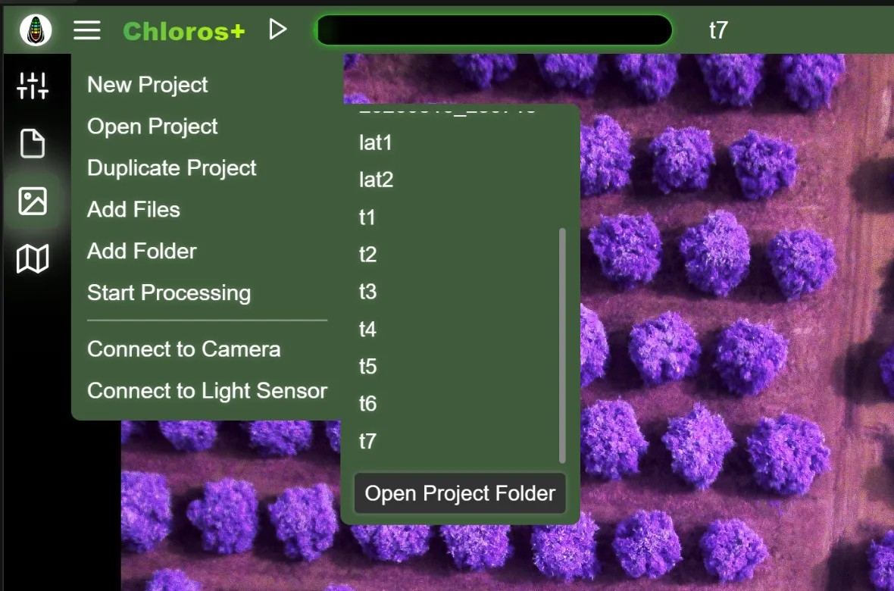

# GUI：プロジェクト

Chlorosでは、後で再開できるプロジェクトを作成できます。プロジェクトとは、（プロジェクトフォルダ内の）単なるフォルダであり、以下のものが含まれます：

* `project.json` — プロジェクト設定、ファイル一覧、表示設定
* `cameras.json` — プロジェクトが開かれている間に接続されたカメラおよびアレイ、およびそれらの設定
* `sensors.json` — プロジェクトが開かれている間に接続された DAQ 光センサー、およびカメラ↔センサーの紐付け
* キャプチャデータ、`.daq` 記録データ、および処理済み出力フォルダ

独自のプロジェクトファイル形式は存在しません。フォルダとそのJSONファイル自体がプロジェクトとなります。これにより、プロジェクトのコピー、アーカイブ、および[CLI](CLI.md)や[Python SDK](api-python-sdk.md)からの操作も容易になります。

[プロジェクト設定](project-settings/project-settings.md)で変更しない限り、プロジェクトフォルダは「ドキュメント」フォルダ内の`Documents\MAPIR\Chloros Projects`（Linuxの場合は`~/Documents/MAPIR/Chloros Projects`）になります。


**Windows：長いパスが有効になっていない限り、プロジェクトフォルダ名は短くしてください。**Windowsでは、長いパス機能はデフォルトで無効になっており、ファイルパスは260文字を超えてはなりません。 処理済みの成果物はプロジェクトフォルダの下に最大約130文字分配置されるため、バージョン1.3.0以降、Chlorosは深すぎるプロジェクトフォルダを拒否します。プロジェクトフォルダを作成または開く際、あるいは処理を開始する際に、実行はされるものの何も書き込まれません。メッセージには、収まる範囲で最も長いプロジェクトフォルダ名が示されます。 プロジェクトフォルダのパスを短くするか、Windowsの長いパス機能を有効にして（インストーラの**「Windowsの長いパスを有効にする」**オプション、デフォルトでチェック済み）、Chlorosを再起動してください。[処理の開始](processing-images-gui/starting-the-processing.md#the-project-folder-is-too-deep-for-this-computer)を参照してください。


## 新規プロジェクト

<figure><figcaption></figcaption></figure>メインメニューから「新規プロジェクト」を選択し、プロジェクトに一意の名前を入力してください。

プロジェクトテンプレートを保存している場合、名前入力欄の下に**テンプレートの選択**ドロップダウンが表示されます。これを選択すると、そのテンプレートの設定に基づいて新しいプロジェクトが開始されます。 テンプレートは [プロジェクト設定](project-settings/project-settings.md) から保存します。「プロジェクトテンプレートの名前」フィールドに名前を入力し、保存アイコンをクリックしてください。

## プロジェクトを開く

<figure><figcaption>
「プロジェクトを開く」には、プロジェクトフォルダ内のすべてのプロジェクトが一覧表示され、下部には「<strong>プロジェクトフォルダを開く</strong>」があります
</figcaption></figure>

「プロジェクトを開く」を選択すると、プロジェクトフォルダ内の既存のプロジェクト一覧が表示されます。プロジェクトが存在しない場合、サブサイドメニューは開きません。上の写真には、GUIで作成されたプロジェクト（t1、t2、t3）がいくつか一覧表示されています。 「DATE\_TIME」という名前のプロジェクトは、CLIがデフォルトのプロジェクト命名規則を使用して作成したものです。任意のプロジェクト名をクリックすると、そのプロジェクトが開きます。

「プロジェクトフォルダを開く」ボタンをクリックすると、お使いのコンピュータのファイルエクスプローラーがプロジェクトのパスで開きます。 プロジェクトパスは、[プロジェクト設定](project-settings/project-settings.md)で調整できます。

プロジェクトを最後に開いてから、ソース画像ファイルが移動または削除されている場合、Chlorosは空白のグリッドを開く代わりに、どのファイルが欠落しているかを正確に一覧表示するダイアログを表示します。

## プロジェクトの複製

プロジェクトが開かれている場合に利用可能です。「プロジェクトの複製」を選択すると、現在のプロジェクトが新しい名前でコピーされます（Chlorosは次に利用可能な名前、例：「MyProject (2)」などを提案します）。複製されたプロジェクトは直ちに開かれます。

## ファイルの追加

プロジェクトを開いた後、メインメニューから「ファイルの追加」を選択すると、個々の画像ファイルを現在のプロジェクトに追加できます。これはファイルブラウザの追加機能と同じですが、利便性のためメインメニューから直接アクセスできます。

## フォルダの追加

プロジェクトを開いた後、メインメニューから「フォルダの追加」を選択すると、画像を含むフォルダを現在のプロジェクトに追加できます。一度に複数のフォルダを選択可能です。重複するファイルは無視されます。

## 処理の開始／停止

プロジェクトにファイルが追加されると、メインメニューに「処理を開始」が表示されます。これは、上部ヘッダーの「再生／開始」ボタンをクリックするのと同じ操作です。処理中は、メニュー項目が「処理を停止」に変わり、パイプラインを中断できるようになります。

## カメラへの接続 / 光センサーへの接続

メインメニューの下部には、プロジェクトが開いているかどうかにかかわらず利用可能な 2 つのハードウェアショートカットがあります：

* **カメラへの接続** — [カメラタブ](lattice/) を開き、LATTICE カメラまたはアレイを接続します。
* **光センサーに接続** — [光センサータブ](daq/) を開き、DAQ光センサーを接続します。

プロジェクトが開いている状態でハードウェアを接続すると、その設定はプロジェクトに保存されます（以下を参照）。プロジェクトが開いていない場合、接続設定はセッション限定となります。


「ファイルの追加」、「フォルダの追加」、「処理の開始/停止」のメニュー項目は、プロジェクトが開かれており、ファイルが追加されている場合にのみ表示または有効になります。これらは、ファイルブラウザのサイドバーやヘッダーのボタンからも利用可能な操作に素早くアクセスするためのものです。


## プロジェクトはハードウェアの設定を記憶します

バージョン 1.2.0 の新機能：プロジェクトが開かれている間、接続したハードウェアの設定が保持されます。 カメラおよびアレイ（各カメラごとの設定、名前、色、グリッドレイアウトを含む）は `cameras.json` に、光センサー（名前、色、カメラへのバインドを含む）は `sensors.json` に — 作業中に自動的に保存されます。

プロジェクトを**再開**する際、Chlorosは直ちにハードウェアにアクセスしません。各コンポーネントは、それに対応するタブを初めて開いた際に再接続されます：

* **カメラ**タブを開くと、保存されたカメラとアレイが再接続され、保存された設定が再適用されます。
* **光センサー**タブを開くと、保存されたDAQセンサーが再接続され、キャップを含む保存された設定が再適用されます。 Capメニューで**None (ベアセンサー)**に設定されたセンサーは、ベア状態のままになります。以前のChlorosで保存されたプロジェクトでは、ベアセンサーは選択肢として認識されなかったため、日射コサイン補正が適用された状態で復元されます。もう一度**None**に設定してプロジェクトを保存してください。

こうすることで、画像の閲覧やエクスポートのみを目的としてプロジェクトを開いた場合でも、カメラがストリーミング状態になることはありません。タブを開いた際に保存済みのデバイスが見つからない場合、どのデバイスが利用できないかを示すダイアログが表示されるため、再接続または削除を行うことができます。

## プロジェクト内のDAQ記録と.daqファイル

* プロジェクトが開いている間に作成された`.daq`記録（「光センサー」タブから、またはキャプチャ中に作成されたもの）は、**自動的にプロジェクトに追加**されます。
* インポートされた `.daq` ファイルおよびすべてのプロジェクト記録は、[プロジェクト設定](project-settings/project-settings.md) の **DAQ 光センサー** セクションに一覧表示され、それぞれにキャップ補正プロファイルが設定されています。
* 処理中、プロジェクトの `.daq` ファイルは、反射率プロダクト用の下向き照明データとして使用されます — [出力画像フォーマット](output-image-formats.md) を参照してください。

## 保存済みプロジェクトのヘッドレス実行

保存済みプロジェクトは、GUI を使用せずに実行できます：

* **CLI**：`chloros-cli project open / connect / capture / sensor / align / run` はプロジェクトフォルダのパスを指定して動作します — [CLI リファレンス](reference/cli-reference.md) を参照してください。
* **SDK**: `chloros_sdk.open_project(path)` はプロジェクトハンドルを返します。 `connect_all()`は、保存された設定（光センサーは実行中のChlorosバックエンド経由）で、保存されたすべてのカメラ、アレイ、および光センサーをオンラインにします — [SDKリファレンス](reference/sdk-reference.md)を参照してください。
